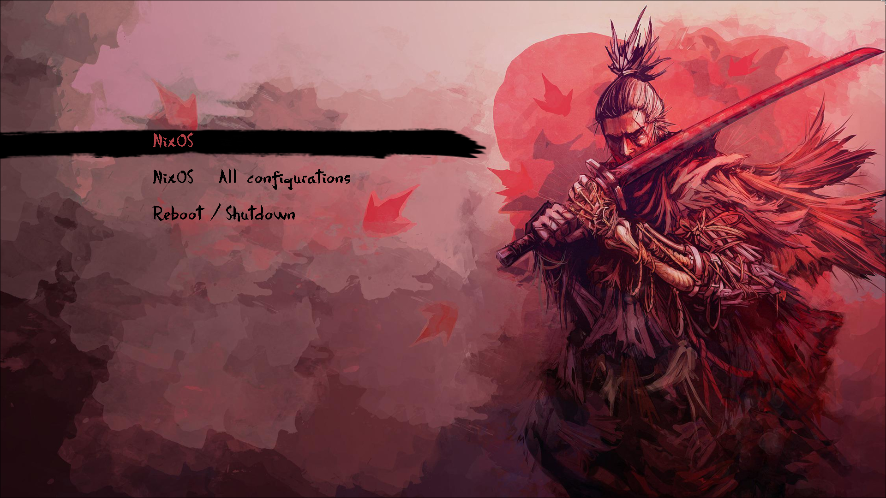
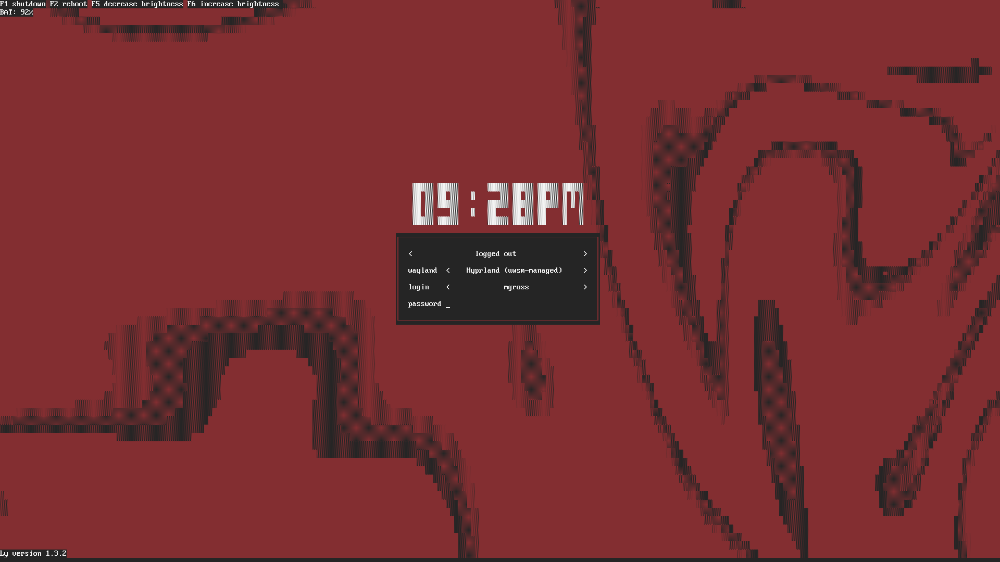
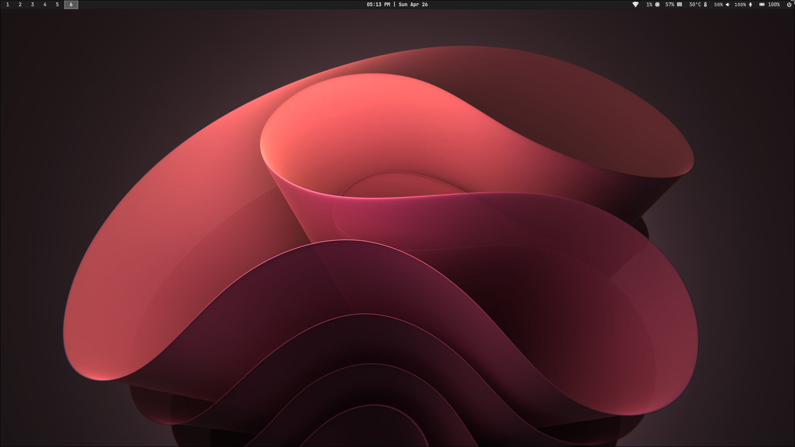
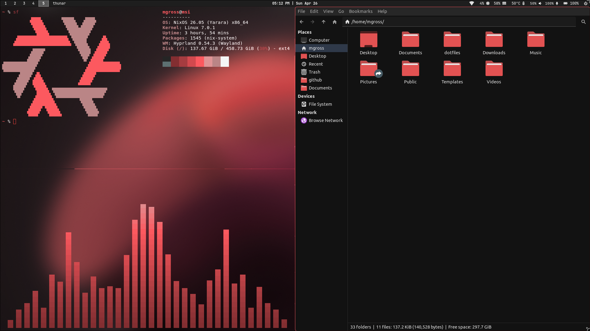
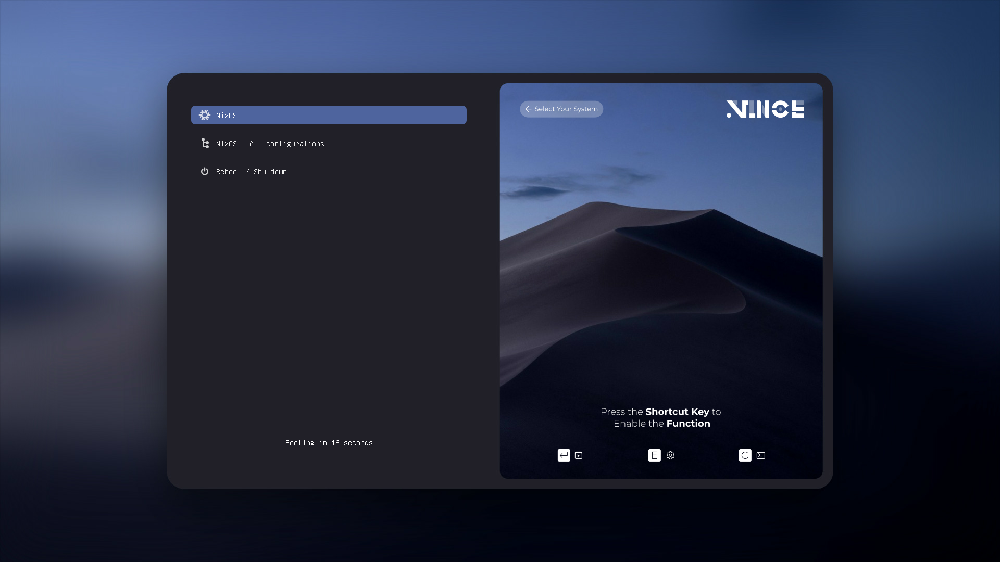
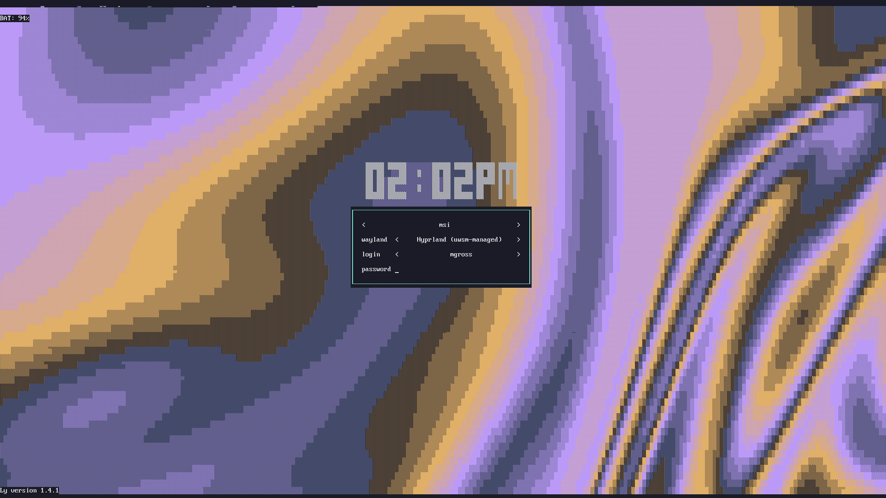
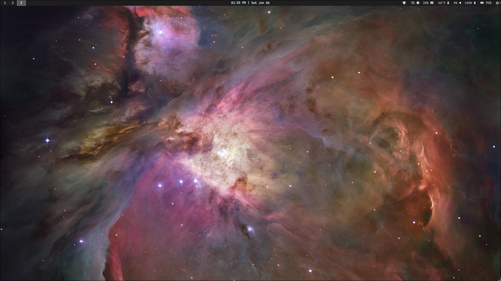

# Dotfiles & Installation

## Theme Catalog

<table>
  <thead>
    <tr>
      <th>Theme</th>
      <th>Boot Screen</th>
      <th>Login</th>
      <th>Desktop</th>
      <th>Application Themes</th>
    </tr>
  </thead>
  <tbody>
    <tr>
      <td><b>Tomorrow Night Burns</b></td>
      <td></td>
      <td></td>
      <td></td>
      <td></td>
    </tr>
    <tr>
      <td><b>Tokyo Night</b></td>
      <td></td>
      <td></td>
      <td></td>
      <td><em>Coming soon</em></td>
    </tr>
  </tbody>
</table>

## System Info

| **Component**     | **Details**                                                          |        **Notes**            |
|-------------------|----------------------------------------------------------------------|-----------------------------|
| **Kernel**        | [Linux](https://github.com/torvalds/linux)                           |  Year of the Linux Desktop  |
| **Distribution**  | [NixOS](https://nixos.org)                                           |         *Nix btw*           |
| **Window Manager**| [Hyprland](https://wiki.hyprland.org)                                |    Tiling / Wayland         |
| **Graphics**      | [NVIDIA](https://wiki.archlinux.org/title/NVIDIA)                    |     Open Kernel Modules     |
| **GRUB Theme**    | [Sekiro](https://github.com/AbijithBalaji/sekiro_grub_theme)         |      From the Ashes         |
| **Terminal**      | [Ghostty](https://github.com/mitchellh/ghostty)                  | Fast, GPU-accelerated       |
| **Shell**         | [Zsh](https://www.zsh.org)                                           |    Z-Shell (*"zish"*)       |
| **Font**          | [Ubuntu](https://design.ubuntu.com/font/)                            |         *sacrilegious*      |
| **System Theme**  | [Materia Dark Compact](https://github.com/nana-4/materia-theme)      |      Based on Adwaita       |
| **Icon Theme**    | [Papirus](https://github.com/PapirusDevelopmentTeam/papirus-icon-theme) |       Red, Dark             |
| **Login Manager** | [Ly](https://codeberg.org/fairyglade/ly)                             |      TUI Login Manager      |

## NixOS Install (From Git)

For existing NixOS systems with flakes enabled:

```bash
git clone https://github.com/MGross21/dotfiles.git
cd dotfiles
sudo nixos-rebuild switch --flake .#msi
```

To stay on the latest nixos-unstable revisions:

```bash
nix flake update
sudo nixos-rebuild switch --flake .#msi
```
